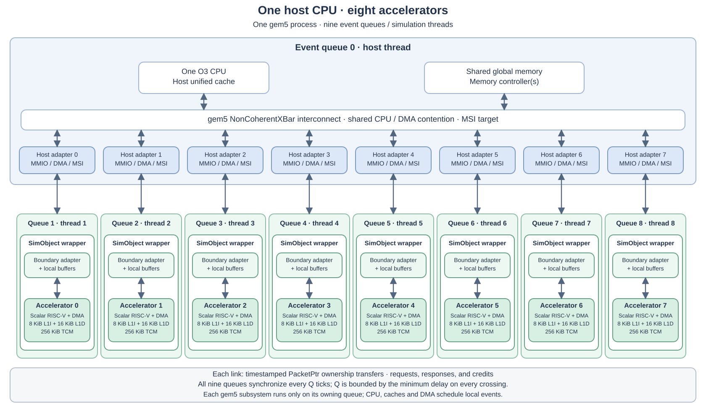
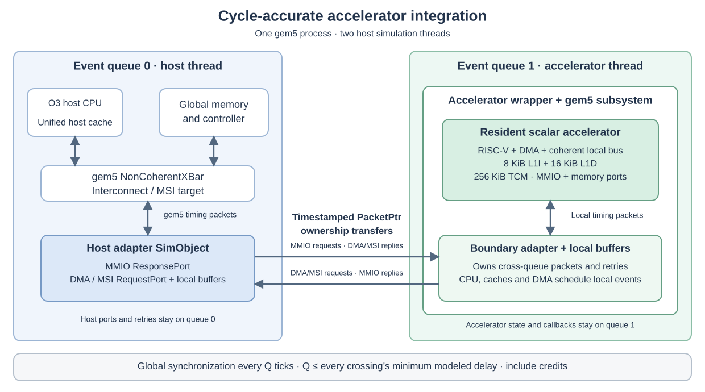
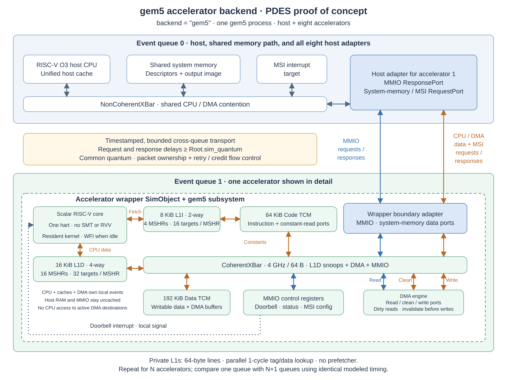

# Accelerator API for cycle-accurate PDES

Each accelerator is a general purpose compute engine built around a
customized multithreaded RISC-V core with a powerful vector processing unit
(VPU). Think of the system as a GPU whose compute engines are multithreaded
RISC-V cores with VPUs in place of conventional SIMT engines. Hardware
threads and vector execution provide parallelism within an accelerator;
PDES provides parallelism between accelerator simulation instances.

Ray tracing is the initial workload, implemented in software by the
**Rendering Kernel**. The accelerator hardware can execute other compute
kernels. The scene and job descriptors, rendering modes, and storage rules
below define the Rendering Kernel's software contract, rather than the
full set of workloads supported by the hardware.

The default system has one O3 host CPU and eight accelerators. The gem5
backend permits 1-32 accelerators through `--accelerator-cores=N`. The host CPU
has a unified cache; each gem5 accelerator has private L1I and L1D caches
backed by TCM. A gem5 `NoncoherentXBar` connects the host CPU cache, shared
memory system, and host adapters. Run the host, its cache, the interconnect,
shared memory system, and all host adapters on gem5 event queue 0.
Place each complete accelerator backend, including its multithreaded core,
VPU, DMA engine, and local memory, behind a SimObject wrapper on its own
queue, numbered 1 through the configured core count. Each host adapter
exposes an MMIO `ResponsePort`
and a system-memory/MSI `RequestPort`; it exchanges timestamped messages
with its accelerator wrapper.
All queues synchronize with a common quantum bounded by the shortest
cross-queue transport delay. Shared memory contention is modeled on queue 0.
Both backends must support eight independent instances without shared mutable
simulation state, each driven by its owning queue.



The library integration detail below shows one host-adapter/accelerator pair.
The API and contracts use queue 1 as the example; they apply identically to
queues 2 through 8. The gem5 backend subsystem is shown in
[gem5 backend proof of concept](#gem5-backend-proof-of-concept).



## Theory of operation

The Rendering Kernel contract targets full-system (FS) execution with an OS or
bare-metal execution without an OS. Initial testing uses bare-metal host
software. Both environments use the same descriptors, MMIO interface, DMA
path, and MSI completion protocol. The
[initial implementation](#initial-implementation) is currently an MMIO mock
and does not yet implement this contract.

1. Before submitting work, simulation initialization loads the Rendering
   Kernel into each accelerator's local tightly coupled memory (TCM).
   Code TCM holds code and constants; Data TCM holds writable storage and
   DMA buffers. The Rendering Kernel stays resident across jobs; loading it
   is not a per-job DMA operation.
2. The host CPU creates a Scene Descriptor and one Job Descriptor per assigned
   accelerator in system memory. Jobs may share an immutable scene and write
   disjoint tiles of the same output image. The host allocates the output and
   makes descriptor writes visible to noncoherent DMA before submission.
3. For each idle accelerator, the host programs its MSI destination CSR and
   writes the system-memory address of its Job Descriptor to the MMIO
   doorbell. That write submits exactly one job to that accelerator. There is
   one outstanding job per accelerator; a doorbell write while busy returns
   an MMIO error and leaves the running job unchanged.
4. The Rendering Kernel DMA-loads the Job Descriptor and scene header into TCM,
   checks counts and capacity, then loads all materials and objects. It
   validates the complete descriptors before rendering or writing any image
   data. All ray traversal and shading use these local copies; the
   Rendering Kernel does not fetch scene data on demand.
5. The Rendering Kernel renders the assigned rectangle. It divides
   rectangles larger than 64 pixels in either dimension into subtiles of at
   most 64x64 pixels, with smaller subtiles at the edges. It completes all
   samples for a subtile, converts it to RGBA8, and DMA-writes its rows to
   the output image before reusing the local tile buffer. The host may assign
   smaller tiles, arbitrary nonzero extents, or a whole image as one job.
6. After all output writes have completed and are visible on the host memory
   path, the accelerator records successful completion and issues one MSI
   write to its programmed destination. Internal subtiles do not generate
   separate completions. The host observes completion and performs any
   required cache invalidation before reading the image.

The only per-job bulk DMA operations are descriptor reads from system memory
and rendered tile writes back to system memory. MSI is a separate completion
write on the same master interface. Code and constants reside in Code TCM;
stacks, random-number state, intersection data, and floating-point sample
accumulation reside in Data TCM;
there are no output-image reads or intermediate spills to system memory.
Each job replaces its output pixels rather than accumulating into an earlier
image. The host keeps descriptors unchanged and all descriptor and output
allocations alive until completion, and does not access output regions owned
by running jobs. Output must not overlap any live descriptor or another
job's output region. Cache maintenance must also account for cache lines
shared by adjacent tiles.

### TCM capacity

Each accelerator has **256 KiB (262,144 bytes) of TCM**: 64 KiB Code TCM
for code and constants, and 192 KiB Data TCM for writable data and DMA buffers.
Code TCM has two read ports sharing one image: the CPU instruction port
connects through L1I to one; CPU constant reads use L1D and the local
data interconnect. The backing Code TCM rejects runtime writes; resident
firmware must not modify code or constants through L1D. DMA sources and
destinations must be in Data TCM or host RAM. This capacity primarily
supports complex kernels and intermediate data structures. For rendering,
it must hold the Rendering Kernel, one Job Descriptor, the entire scene,
all working storage, and at
least one 64x64 RGBA8 tile (16,384 bytes).

The Rendering Kernel uses no dynamic memory allocation. All storage is
allocated statically at compile time, including descriptor buffers, material
and object arrays, stacks, ray state, floating-point accumulators,
intermediate data structures, and the image tile. Runtime scene counts and
ray depth select how much of this fixed storage is used; they never trigger
allocation or resizing. The Rendering Kernel build must verify that its
code/constants layout fits within 64 KiB and its writable-data layout,
including alignment padding and reserved stack space for all hardware
threads, fits within 192 KiB. For the layouts below, its storage budget
must satisfy:

```text
 65536 >= Rendering Kernel code and constants bytes
196608 >= Other writable static data bytes
          + 56                            # Job Descriptor buffer
          + 56 + 24*M_max + 40*N_max       # Scene buffer at capacity
          + statically reserved scratch bytes
          + 16384                         # RGBA8 tile
```

Here `M_max` and `N_max` are the compile-time material and object capacities,
not the current job's counts. Scratch includes stacks, alignment padding,
ray state, and any floating-point accumulators or locally built acceleration
structure; each storage region is counted only once in this budget. A linear
scan of the objects is sufficient; an acceleration structure is not part of
the descriptor format, and any such structure uses statically reserved space.
The Rendering Kernel must publish its scene-count and ray-depth limits and
reserve enough storage for their worst case. Jobs exceeding these limits
fail before rendering; scenes are not streamed from system memory. A larger
job rectangle only increases the number of subtiles and must not require a
larger local image buffer.

### Doorbell and completion control

The following are the required logical CSRs. Their byte offsets belong to
the hardware register map; these names define their behavior.

| CSR | Width | Behavior |
| --- | --- | --- |
| `DOORBELL` | 64 bits | Write a Job Descriptor address to submit work. |
| `MSI_ADDR` | 64 bits | Address of the host MSI target. |
| `MSI_DATA` | 32 bits | Payload of the completion MSI write. |
| `STATUS` | 32 bits | Read-only: 0 idle, 1 busy, 2 done, 3 error. |

The doorbell requires one aligned 64-bit MMIO write. On acceptance it latches
the job address and MSI configuration and sets `STATUS` to busy. Writes to
MSI configuration while busy return an MMIO error. Done and error are
terminal states that permit a new submission; accepting that submission
clears the previous status. There is no descriptor queue or completion
record in system memory. The host must consume the previous job's completion
notification and status before submitting the next job to that accelerator.
Each MSI is one aligned 32-bit write of `MSI_DATA` to `MSI_ADDR`.

An invalid descriptor, insufficient TCM, or descriptor/output DMA failure
sets error status and produces the same completion MSI as a successful job;
the host reads `STATUS` to distinguish the result. Any outstanding DMA must
be drained before that notification. A failed job's output is invalid and
may be partially written after an output DMA failure. The host must configure
a valid MSI target before submission. MSI delivery failures leave error
status readable through MMIO but cannot guarantee an interrupt.

The platform supplies an MSI-capable interrupt target. Bare-metal host
software configures interrupt routing and installs the completion handler;
in an OS-based FS environment, the host driver performs this setup through
the OS. The MSI is a modeled write that reaches the platform interrupt
target after output visibility, as required by the timing contracts below.

## Descriptor memory format

These descriptors define the Rendering Kernel's initial job format. Other
compute kernels can define their own workload data formats on the same
general purpose accelerator.

The Scene Descriptor and Job Descriptor are serialized data structures
created by the host in simulated system memory and consumed by the Rendering
Kernel. All offsets and sizes below are in bytes. Integers are unsigned
little-endian `u32` or `u64`; `f32` is little-endian IEEE 754 binary32.
`f32[3]` stores three consecutive components. Every floating-point field must
be finite. The listed layouts have no implicit padding or native pointers;
host and Rendering Kernel code must use these offsets, not assume a compiler
ABI.
Both descriptor bases are 8-byte aligned.

Every address in a descriptor or CSR is a simulated system physical/bus
address, never a simulator-process pointer or an untranslated host virtual
address. Initial bare-metal tests reserve DMA-accessible system-memory
ranges and use their bus addresses directly. In an OS-based FS environment,
the host driver allocates DMA-accessible buffers and supplies their bus
addresses, keeping the allocations and mappings valid until completion.
Each descriptor and output allocation must occupy a contiguous bus-address
range for its full size; virtual contiguity alone is insufficient. All size
and address arithmetic must be checked for overflow. These layouts define a
single initial format; there are no optional extensions or indirect asset
references.

## Scene Descriptor

A scene is one contiguous allocation containing a 56-byte header, followed
immediately by `material_count` 24-byte material records, then `object_count`
40-byte object records. Its total size is
`56 + 24*material_count + 40*object_count` bytes. Array order defines
zero-based indices; the header contains no further pointers.

| Offset | Type | Field | Meaning |
| --- | --- | --- | --- |
| 0 | `u32` | `material_count` | Number of materials; at least one. |
| 4 | `u32` | `object_count` | Number of triangle objects; at least one. |
| 8 | `u32` | `image_width` | Full image width in pixels; nonzero. |
| 12 | `u32` | `image_height` | Full image height in pixels; nonzero. |
| 16 | `f32[3]` | `camera_position` | Pinhole position in world coordinates. |
| 28 | `f32[3]` | `camera_target` | Point the camera looks toward. |
| 40 | `f32[3]` | `camera_up` | Reference up direction. |
| 52 | `f32` | `vertical_fov` | Vertical field of view, degrees in (0, 180). |

The camera position and target must differ. Define
`forward = normalize(camera_target - camera_position)`,
`right = normalize(cross(forward, camera_up))`, and
`up = cross(right, forward)`. `camera_up` must be nonzero and not parallel to
`forward`. Image coordinates start at the upper-left, with x increasing
rightward and y downward. Pixels are square; aspect ratio is
`image_width / image_height`. For a sample at pixel `(x, y)` plus offsets
`(sx, sy)` within that pixel, the ray originates at `camera_position` and has
direction:

```text
h = tan(vertical_fov * pi / 360)
u = (2 * (x + sx) / image_width - 1) * (image_width / image_height) * h
v = (1 - 2 * (y + sy) / image_height) * h
direction = normalize(forward + u * right + v * up)
```

All divisions here are real-valued. Camera rays always use full-image
coordinates, including when the host or accelerator subdivides the image.

### Material record

| Offset | Type | Field | Meaning |
| --- | --- | --- | --- |
| 0 | `f32[3]` | `albedo` | Linear RGB diffuse reflectance, each in [0, 1]. |
| 12 | `f32[3]` | `emission` | Linear RGB emitted radiance, each nonnegative. |

Every surface is opaque and Lambertian, with diffuse BRDF `albedo / pi`.
Emission is constant over each face and may coexist with diffuse reflection.
A nonzero emission makes the triangle an area light; no separate light list
is needed. All surfaces are two-sided: orient the geometric normal toward
the incoming ray for reflection, and emit equally from both sides. A ray
that misses all geometry sees black.

### Object record

Each object is a single flat triangle in world coordinates.

| Offset | Type | Field | Meaning |
| --- | --- | --- | --- |
| 0 | `u32` | `material_index` | Index less than `material_count`. |
| 4 | `f32[3]` | `v0` | First vertex. |
| 16 | `f32[3]` | `v1` | Second vertex. |
| 28 | `f32[3]` | `v2` | Third vertex. |

Vertices must form a nondegenerate triangle. The geometric normal is derived
from `cross(v1 - v0, v2 - v0)`; back faces are not culled. The host supplies
final vertices, so no transform hierarchy is required. Two triangles form
a rectangular wall or light, and twelve form a box. This supports a Cornell
box with colored walls, interior boxes, and an emissive ceiling panel.
Textures, smooth normals, refraction, and additional primitive or material
types are outside the initial format.

## Job Descriptor

A Job Descriptor is a fixed 56-byte record for one accelerator. The MMIO
doorbell selects the accelerator, so no accelerator ID is stored here.

| Offset | Type | Field | Meaning |
| --- | --- | --- | --- |
| 0 | `u64` | `scene_addr` | Bus address of the complete Scene Descriptor. |
| 8 | `u64` | `output_addr` | Bus address of full-image pixel (0, 0). |
| 16 | `u32` | `output_stride` | Distance in bytes between output row starts. |
| 20 | `u32` | `tile_x` | Leftmost assigned pixel in full-image coordinates. |
| 24 | `u32` | `tile_y` | Topmost assigned pixel in full-image coordinates. |
| 28 | `u32` | `tile_width` | Assigned width in pixels; nonzero. |
| 32 | `u32` | `tile_height` | Assigned height in pixels; nonzero. |
| 36 | `u32` | `render_mode` | 0: path tracing; 1: ray-tracing smoke test. |
| 40 | `u32` | `samples_per_pixel` | Integration iterations per pixel. |
| 44 | `u32` | `max_secondary_depth` | Maximum continuation rays per path. |
| 48 | `u64` | `seed` | Seed for deterministic path-tracing sampling. |

The assigned rectangle is half-open:
`[tile_x, tile_x + tile_width) x [tile_y, tile_y + tile_height)`.
It must fit entirely within the scene's image dimensions. `output_addr` and
`output_stride` must be multiples of four, and the stride must be at least
`4 * image_width`. The output allocation covers at least
`(image_height - 1) * output_stride + 4 * image_width` bytes. Pixel `(x, y)`
is stored at `output_addr + y * output_stride + 4 * x`. Accelerators write
only assigned pixels, leaving row padding and other pixels untouched.

Output pixels are four bytes in R, G, B, A order. RGB stores the mean linear
radiance, with each channel converted as
`floor(255 * clamp(channel, 0, 1) + 0.5)`; alpha is always 255. No gamma
conversion, exposure adjustment, or tone mapping is applied by the
Rendering Kernel.

### Rendering parameters

**Path tracing (`render_mode = 0`).** `samples_per_pixel` must be at least
one. Each iteration traces one independent camera path with uniform random
subpixel offsets in `[0, 1)`, accumulates its radiance locally, and contributes
to the pixel mean. At each hit, add the material's emission multiplied by
the current path throughput. If continuation is allowed, sample a
cosine-weighted direction over the oriented normal's hemisphere and multiply
throughput by the material's albedo. Start with unit throughput. Stop on a
miss, zero throughput, or the depth limit. This initial integrator uses
emitter hits for illumination; it has no separate direct-light sampling or
Russian roulette.

The primary ray is depth zero. `max_secondary_depth = 0` permits only the
primary hit's emission; a value of one permits one diffuse continuation ray,
and so on. A hit at the final permitted depth still contributes emission.
Depth is a per-path bound, not a total ray budget for a pixel or job.
Sampling must be derived from `seed`, full-image pixel coordinates, and
sample index, independently of accelerator identity, job partition, subtile
order, or event queue scheduling. A fixed Rendering Kernel implementation
must reproduce the same pixels for the same inputs under those scheduling
and tiling changes.

**Ray-tracing smoke test (`render_mode = 1`).** Require
`samples_per_pixel = 1` and `max_secondary_depth = 0`; `seed` is ignored.
Trace one camera ray through each pixel center (`sx = sy = 0.5`). At its
nearest hit, return surface emission plus direct Lambertian illumination
from every other emissive triangle, approximated by its centroid and area.
For each light with an unobstructed segment to its centroid, add
`(albedo / pi) * light_emission * area * cos_surface * cos_light / distance^2`,
componentwise in RGB. `cos_surface` is the nonnegative cosine at the shaded
surface and `cos_light` is the absolute cosine at the two-sided emitter.
An occluded light contributes zero. Shadow rays are visibility tests and do
not count as continuation rays. This mode has hard shadows and no indirect
illumination or stochastic sampling, making it suitable for quick tests.

Both modes use nearest positive intersections and must avoid self-hits when
spawning rays. Numerical tolerances, shared-edge tie breaking, and the
random generator are fixed and documented by the Rendering Kernel
implementation. Unknown mode values, invalid fields, or values beyond
configured limits are errors; the accelerator must not silently clamp
counts, depths, or tile bounds.

## Conceptual C++ interface

The library backend models the customized multithreaded RISC-V core, VPU,
DMA engine, and TCM. Its interface is independent of the compute kernel
running on the core. The accelerator library is compiled against gem5
headers and exchanges `gem5::PacketPtr` directly, without copying packets
or payloads at the API boundary. DMA still transfers data between system
memory and TCM. The packet command identifies a read or write; the response
is written into the same
packet. Document the supported AXI subset, its mapping to packet metadata,
and how transaction acceptance maps to channel handshakes.

```cpp
#include <functional>

#include "base/types.hh"
#include "mem/packet.hh"

using gem5::Tick;
using gem5::PacketPtr;

// Returns exclusive packet access to the initiator before its body executes.
using Completion = std::function<void(Tick, PacketPtr)>;

struct LinkTiming
{
    Tick requestDelay;
    Tick responseDelay;
};

class PortAPI
{
  public:
    virtual ~PortAPI() = default;
    // True: takes packet ownership until completion; retains callback.
    // False: caller keeps ownership; no side effects or completion callback.
    virtual bool trySubmit(Tick arrival, PacketPtr pkt,
                           Completion done) = 0;
};

class Accelerator : public PortAPI
{
  public:
    virtual void connectNonCoherentBus(PortAPI &responder) = 0;
    // Initialization only: transfer these documented stages to the wrapper.
    virtual void useExternalTransport(LinkTiming mmio,
                                      LinkTiming master) = 0;
    // Execute exactly one accelerator clock edge; time advances only here.
    virtual void runCycle(Tick edge) = 0;
};
```

## Timing and ownership contracts

The transport, ownership, and queue-isolation rules apply to both backends
and all compute workloads. The `runCycle()` and callback rules describe the
library backend; the gem5 backend schedules native CPU and device events.
The core's hardware threads and VPU execute within its accelerator's event
queue, independently of the host threads used to run PDES.

1. **Explicit clocking.** The accelerator documentation specifies clock period,
   phase, and input sampling rules. Calls to `trySubmit` stage inputs; they do
   not advance time. Inputs arriving at an edge are delivered before `runCycle`
   for that edge. The model emits bus requests and slave completions only
   during `runCycle`, stamped with that edge's time. Host responses are
   delivered on queue 1 and staged for the appropriate edge. No private
   simulation threads, wall-clock progression, or asynchronous callbacks are
   permitted.

2. **Real transport stages.** External transport replaces documented hardware
   pipeline stages, preserving when requests first affect state, when responses
   become visible, buffering, throughput, and backpressure. It must not merely
   move a response delay before a request. A ten-cycle minimum completion time
   does not establish a removable ten-cycle transport stage. The accelerator
   must identify the actual stages and reject unsupported external
   configurations.

3. **Positive lookahead.** Each adapter schedules delivery on the other queue
   at emission time plus the modeled transport delay. Every crossing, including
   flow-control notifications, must have minimum delay at least
   `Root.sim_quantum`. This applies to MMIO and master requests and responses.
   Preserve exact timestamps and specified clock sampling; do not round to
   quantum boundaries. If a required crossing has zero delay, this partition
   cannot use a positive quantum without a different synchronization design.

4. **Local acceptance.** `trySubmit` returns immediately based on local buffer
   capacity. On rejection, the caller retains the request and may retry at a
   later clock edge. On acceptance, completion occurs exactly once, returning
   the same packet pointer, and never inline within `trySubmit`. Acceptance is
   not completion. Cross-queue buffers are bounded and use explicit credits or
   equivalent flow control; no call
   waits synchronously for the other queue. The wrapper preserves gem5 retry
   semantics and the accelerator's supported outstanding-transaction limits.

5. **Packet ownership.** An accepted master request transfers exclusive access
   to the packet and its payload from the accelerator to the gem5 adapter until
   `Completion` returns that ownership to the accelerator. MMIO follows the
   same rule in reverse. The initiator must not inspect, modify, reuse, or free
   the packet or aliased payload while it is outstanding. The responder fills
   the same packet and relinquishes access before invoking completion; it must
   not delete the packet or access it afterward. The initiator is responsible
   for keeping storage alive and reclaiming it after ownership returns.

6. **Thread handoff.** All library calls and accelerator callbacks execute on
   queue 1. Queue 0 alone accesses host timing ports. Transport messages carry
   the raw pointer and transfer exclusive access through synchronized event
   delivery, without copying its payload. After publishing a message, the
   sender cannot access the packet; the receiver accesses it only at the
   scheduled delivery time. The wrapper retains each accelerator master
   callback on queue 1 and invokes it only after the response pointer returns
   to that queue at its modeled arrival time. Completion on queue 0 does not
   itself return ownership to the accelerator.

7. **Ordering and visibility.** Preserve AXI ordering, byte enables, and the
   specified relationship between result writes and MSI writes. Do not replace
   the accelerator's MSI transaction with a premature CPU interrupt.
   Noncoherent DMA uses the modeled host memory path and software cache
   maintenance. Same-time messages have a documented deterministic ordering
   independent of host thread scheduling.

For example, a genuinely removable round-trip transport of ten cycles could be
split into five cycles each way, permitting a quantum of at most five cycles if
all other crossings satisfy it. Total latency is then ten cycles **plus**
engine service time; this is not equivalent to a ten-cycle minimum.

## Acceptance criterion

First compare the accelerator's original timing configuration with external
transport on one event queue. Then compare that model on one and two queues.
For identical inputs, require identical transaction acceptance, issue and
completion cycles, payloads, ordering, and MSI visibility, including under
backpressure and concurrent CPU/DMA traffic. Schedule `runCycle` as individual
gem5 clock events so inputs and synchronization events can interleave.

## Initial implementation

The shared library lives in [src/rt_accel/](../src/rt_accel/), with public
interfaces in [api.hh](../src/rt_accel/api.hh) and
[accelerator.hh](../src/rt_accel/accelerator.hh). The SimObject adapters live
in [src/dev/rt_accel/](../src/dev/rt_accel/).
Building `build/RISCV/gem5.opt` also builds and links
`build/RISCV/librt_accel_opt.so`; the executable locates it relative to its
own directory. Build both together to keep their gem5 and C++ ABI consistent.

On Linux, regular SCons builds also build and statically link the Volna VTR
C interface from the `ext/volna` submodule. Initialize it with
`git submodule update --init ext/volna`. Cargo, the Rust toolchain selected
by Volna, and `pkg-config` are required; the viewer and nested submodules
are not built. Cargo outputs and installed headers/library stay under
`build/<configuration>/ext/vtr/`. gem5 C++ sources can include `vtr.h`
without extra include or linker flags. Use `--without-vtr` to disable this
integration. This supplies the interface for tracing; it does not enable
trace recording by itself.

The current library is an independent, zero-initialized MMIO storage mock per
instance. It supports bounded requests, masked writes, error responses, and
completion no earlier than one clock after acceptance. It does not execute
RISC-V instructions, model hardware multithreading or a VPU, execute the
Rendering Kernel, or generate DMA/MSI traffic. Atomic and
functional MMIO, checkpoint persistence, and dynamic clock changes are not
implemented. The factory takes the MMIO range, clock period, queue capacity,
and DMA requestor ID; `idle()` lets the wrapper participate in draining.

[configs/example/rt_accel.py](../configs/example/rt_accel.py) retains the
bare-metal RISC-V O3 software rendering reference with `--backend=reference`.
In that mode all eight mock accelerators remain idle and the host submits no
MMIO jobs; this reference validation uses one event queue. The default
`--backend=gem5` executes the rendering kernel on eight scalar accelerator
cores as described below. The host creates
the descriptors specified above and the reference consumer renders a fixed
Cornell scene, including triangle meshes for spheres. See
[the Rendering Kernel README](../util/rt_reference/README.md) for build
instructions, render parameters, fixed storage limits, and numerical
conventions. Rendered images and descriptor dumps are exported through
gem5 pseudo-operations.

Run the accelerator MMIO mock's C++ tests with
`build/RISCV/rt_accel/accelerator.test.opt` after building that SCons target.
The test source is
[accelerator.test.cc](../src/rt_accel/accelerator.test.cc).

## gem5 backend proof of concept

The configuration parameter selects the accelerator implementation
at simulation initialization:

```python
backend = "gem5"  # Scalar RISC-V + L1I/L1D + DMA + TCM; one hart, no RVV
```



This backend models each accelerator as a regular gem5 subsystem constructed
by a Python configuration: a scalar RISC-V core, private L1I/L1D caches,
a DMA engine,
64 KiB Code TCM, 192 KiB Data TCM, and MMIO control registers. The PoC uses
**one hart per core, without SMT** (`numThreads = 1`). SMT is not needed
to demonstrate PDES correctness or simulation speedup across accelerator
event queues. The customized multithreaded core remains the target hardware
architecture; the PoC executes the Rendering Kernel on a single hart per
core. **RVV is not needed for the PoC and will not be implemented in this
phase.** The Rendering Kernel uses scalar instructions. RVV execution and
modeling the target VPU are planned for future work. Document the CPU model
used by the PoC.

A wrapper SimObject exposes the same accelerator boundary as the wrapper
for the cycle-based simulation library: host MMIO requests and responses,
accelerator system-memory/MSI requests and responses, and the timing and
packet ownership contracts specified above. The host uses the same
descriptors, doorbell, status registers, and completion protocol with either
backend.

The local interconnect is a `CoherentXBar`. Both the wrapper's
MMIO port and its system-memory data port connect to this interconnect,
along with L1D, the DMA engine, constant-read port of Code TCM,
Data TCM, and control registers. Instruction fetch connects through L1I to
the other Code TCM port. Local coherence covers L1D and DMA; the host path
remains noncoherent and requires the host cache maintenance described above.
Incoming host MMIO reaches the control registers through the local crossbar.
Both the DMA engine and the accelerator RISC-V CPU can access system memory
through the local crossbar, wrapper, and queue-0 host adapter. The CPU can
therefore read system memory as well as TCM. DMA has no direct connection
to the wrapper; its local and system-memory accesses use the crossbar.

After initialization, the accelerator core's single hart normally waits
in `WFI` (Wait for Interrupt) while idle. An accepted host doorbell write
raises a local Job Submission interrupt from the control registers to the
core. The interrupt wakes the hart to process the Job Descriptor and execute
the scalar Rendering Kernel. After completing the job and issuing its host
completion notification, the hart returns to `WFI` to await the next
submission. The local Job Submission interrupt is distinct from the MSI
that notifies the host of job completion.

Each accelerator's complete subsystem, including its wrapper, core, DMA,
TCM, and local interconnect, runs on its own event queue. The host CPU,
host cache, shared memory path, and eight host adapters remain on queue 0.
All communication between those queues passes through the timestamped,
bounded transport described above, with positive lookahead and a common
synchronization quantum. The accelerator CPUs and devices schedule their
own gem5 events; the wrapper does not drive them through `runCycle()`.

The goal of this proof of concept is to demonstrate that multiple event
queues preserve the modeled behavior and deliver the desired simulation
speedup from PDES. Compare the same gem5 backend and rendering workload
with all components on one event queue and with the host and eight
accelerators on nine queues. Keep clocks, transport delays, the Rendering
Kernel binary, inputs, and simulated work identical. Require identical output,
transaction timing and ordering, and completion visibility. Measure wall
time for the same simulated interval and report speedup as single-queue
wall time divided by parallel wall time, together with the workload,
quantum, and host machine configuration. A speedup target must be stated
before evaluating performance; using multiple queues alone does not
establish success.

### Implemented scalar backend

The PoC defaults to eight `RiscvTimingSimpleCPU` cores
(`--accelerator-cpu=timing`); `--accelerator-cpu=o3` uses `RiscvO3CPU`
instead. Both models use one hart per accelerator and connect
to the same split TCM memory path. The host is always `RiscvO3CPU`,
and all cores are clocked at 1 GHz. `--queues=1` assigns every object to
queue 0; `--queues=N+1` assigns the complete accelerator systems to
queues 1-N, where `--accelerator-cores=N` defaults to eight and accepts
1-32. Host MMIO windows are consecutive 4 KiB ranges starting at
`0x10000000`. The MSI target exposes the hardware count at `0x20000108`;
its pending bitmap and write-one acknowledgement are at `0x20000100`
and `0x20000104`, beyond the 32 possible MSI words. The same host firmware
reads this count and assigns one rectangle to each detected accelerator.
Separate `RiscvSystem` objects isolate TCM, thread contexts and workloads.
Both modes load the same resident scalar ELF into Code TCM and Data TCM.
Code TCM uses `AbstractMemory` and two independent `SimpleTimingPort` read
ports, each with 1 ns response latency. Data TCM uses `SimpleMemory` with
1 ns response latency and 128 GiB/s bandwidth. The local 64-byte-wide
`CoherentXBar` runs at 4 GHz with zero added pipeline stages; native
arbitration and payload serialization still apply. CPU and devices remain
at 1 GHz. L1I is 8 KiB / 2-way with four MSHRs and 16 targets per MSHR.
L1D is 16 KiB / 4-way with 16 MSHRs, 32 targets per MSHR and 16 write
buffers. Both use 64-byte lines, parallel one-cycle tag/data lookup and
one-cycle response latency at the CPU clock. No prefetcher is installed.
Hits stay at the CPU interface; misses coalesce into line fills and retry
downstream independently of the O3 load queue. Instruction fetch uses its
own TCM port. These capacities suit the small reduction kernel; larger
rendering instruction footprints may benefit from a larger L1I.
`--accelerator-caches=none` retains the cacheless, noncoherent local path
for controlled comparisons.
The native boundary is implemented by
[Gem5Wrapper](../src/dev/rt_accel/gem5_wrapper.hh); both backends share
[HostAdapter](../src/dev/rt_accel/host_adapter.hh) and timestamped transport.
The control device contains an independently scheduled DMA engine whose
independent pipelined read and write request ports access Data TCM and
host memory through the local crossbar. It never accesses TCM through
simulator pointers.

DMA reads snoop L1D and can obtain dirty CPU bytes. Before a Data TCM
write, the DMA engine sends a line-aligned `CleanInvalidReq` to the local
point of coherency and waits for its response. This writes dirty neighbors
back and invalidates cached copies before the uncached byte-range write.
An independent coherence request port prepares one chunk per device cycle
while the read and write ports continue issuing in parallel.
The chunk credit covers this extra phase; DMA completion still waits for
the destination write response. Firmware must not access a DMA destination
while that transfer is active. Host RAM and MMIO remain uncached in the
accelerator CPU, and Code TCM remains immutable after initialization.

The default request and response links each model a five-cycle (5 ns) stage
at the 1 GHz CPU/device clock; local bus and device service delays are
additional. The PDES quantum equals the per-direction transport delay,
the largest safe value for these links: five cycles (5 ns) by default.
These links and same-time arbitration priorities are retained in serial
mode. See the
[backend guide](../util/rt_reference/README.md#configurable-gem5-backend)
for firmware, noncoherent visibility, interrupt handling, bounded credits,
export conventions and the correctness/performance validation commands.
The deterministic smoke workload covers 96x96 pixels: eight concurrent
48x24 tiles by default, or sixteen 24x24 tiles for sixteen cores. Other
counts use integer rectangle boundaries that cover the full image without
gaps or overlap. The host waits for all discovered cores to complete before
consuming the image. The speedup target for identical eight-core work is
**greater than 2x**, with no relaxation of simulated timing or output.

The host firmware measures each submitted batch with m5 pseudo ops:
reset statistics after scene/tile preparation, then dump/reset after all
completions and status checks, before output export. It waits past the
configured quantum around each deferred statistics event. IPC therefore
excludes boot and host preparation, while retaining accelerator descriptor
DMA, job setup and rendering within the batch. The backend guide describes
the saved region boundaries and the separate final export statistics.

### Memory-bound reduction workload

[The reduction guide](../util/rt_reference/REDUCTION.md) defines a separate
16-accelerator binary32 sum test. Python initializes 16 MiB of contiguous
`1.0f` inputs before simulation; the host assigns disjoint 1 MiB regions.
Each resident scalar O3 kernel streams through two 64 KiB Data TCM buffers,
overlapping DMA of the next tile with accumulation of the current tile.
The host validates all 16 partial sums against `262144.0f` and their final
sum against `4194304.0f`.

With the historical 100 ns links and quantum, the private L1I/L1D
configuration completed this batch in 150,360 cycles versus 306,407 cycles
for a cacheless comparison with identical firmware, four memory controllers
and either one or seventeen event queues.
That is a 2.038x modeled throughput improvement. See the reduction guide's
[cache measurement](../util/rt_reference/REDUCTION.md#private-l1-cache-measurement)
for repeated wall times, coherence checks and artifact hashes.

The shared RAM latency is 100 cycles of the 1 GHz host/system clock (100 ns).
Its bandwidth is 32 GiB/s for reduction; the separate single-core DMA probe
uses 64 GiB/s to provision the sustained 64-byte/cycle target.
The 4 GHz crossbar clocks do not determine these cycles. Request and response
transport stages and the PDES quantum are now five CPU/device cycles (5 ns).
Saved reduction measurements used 100 ns links and quantum; saved ray-tracing
measurements used 1 us links and quantum. Their timing and speedup results
must be remeasured for the current defaults. Both DMA chunk credits and
transport credits are 512. The DMA read and write ports each issue at most
one 64-byte request per accelerator cycle; per-packet phase/offset state
tracks concurrent completion and retries. DMA success/error is visible only
after all accepted transactions drain, and result-write completion precedes
MSI. Partially overlapping source/destination ranges are rejected.

The experiment harness compares one queue with seventeen queues, checks all
simulated statistics and complete transaction traces, verifies a separate
single-accelerator 64-byte/cycle read/write throughput probe, and reports
untraced wall-clock speedup. Patterned transfers and injected read/write
response failures cover backpressure, byte placement and error draining.
See the guide for exact clocks, bandwidth rounding, memory layout, commands,
measurement intervals, reusable modules and the measured results.

## Library backend (future work)

```python
backend = "library"  # Cycle-based simulation library
```

This backend will use a library that wraps the general purpose accelerator's
RTL, including its customized multithreaded RISC-V core and VPU, compiled
into C++. The library implements the
[Conceptual C++ interface](#conceptual-c-interface) above.
Its wrapper SimObject will stage incoming transactions and drive
`runCycle()` at accelerator clock edges, forwarding core and DMA
system-memory/MSI requests and returning responses according to the same
timing and ownership contracts.

It will use the same PDES implementation, host adapters, cross-queue
transport, event-queue assignment, and synchronization rules as the gem5
backend. The SimObjects on the accelerator event queues will be
implemented differently, while retaining the same host-visible interface.
Backend selection will occur at configuration time. Matching the software
contract across backends does not by itself imply identical internal
execution timing; that requires matching their hardware timing models.
