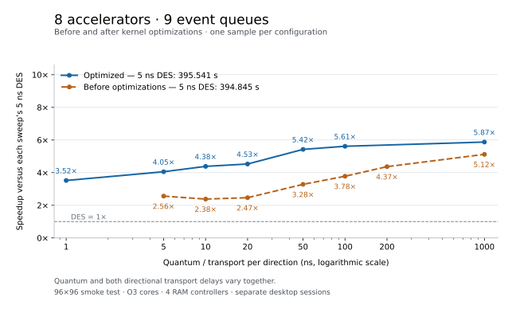
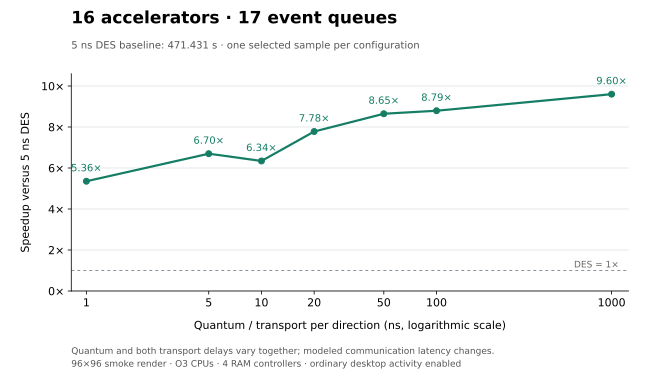

# Ray-tracing results with the optimized simulator

Fresh measurements of the **96x96 raytrace smoke test**, collected from
`2026-10-12T04:32:43Z` through `2026-10-12T05:18:09Z` on
commit `bc835e3176`. The table selects **one fresh sample per
configuration**, with no averaging or profiling. The initial sweep ran each
of the 17 requested configurations once. Three replacements were then
explicitly approved: one retry of a failed DES baseline and clean recaptures
of two PDES samples affected by a diagnostic process. All 20 attempts are
preserved; 19 completed successfully, and 17 are selected
for the table. Historical samples are excluded.

At the realistic **5 ns quantum and 5 ns transport per direction**, measured
PDES speedup over the corresponding fresh one-queue DES baseline is
**4.055x** with 8 accelerators (97.546 s);
**6.698x** with 16 accelerators (70.383 s).

## Implemented optimizations

The following simulation optimizations are retained in the measured executable:

1. **Cache the immutable RISC-V Smrnmi capability** (`b9827ebc69`). Interrupt
   checks and address translation reuse a predicate computed during ISA
   construction instead of repeatedly searching the extension set.
2. **Poll briefly before parking at the quantum barrier** (`2390a8ab58`).
   Periodic synchronization uses an atomic generation barrier with a default
   budget of 32,768 processor-relax iterations. Arrival and generation counters
   occupy separate cache lines. Short waits stay in user space; longer waits
   block. Completion still runs before any participant resumes, with the
   required event-queue lock. Other global events retain blocking barriers.
3. **Batch cross-queue events by producer** (`bdf1e544cf`). Channels are created
   lazily for communicating worker/destination pairs. Workers append to private
   vectors and publish active batches before global barriers. Three reusable
   buffers separate staging, publication and consumption; a channel mutex
   protects batch transfer instead of every event post. Global events,
   completion callbacks and external producers retain the shared inbox.
   Stable queue identities and shared channel ownership preserve lifetime rules.
4. **Reuse shared asynchronous inbox capacity** (`bc835e3176`). A vector replaces
   the linked list in the remaining shared inbox. Draining clears the vector
   without releasing capacity, removing repeated list-node allocation/free for
   synchronization posts while preserving the mutex and posting order.

The measured modeled system also includes these earlier improvements:

5. **Separate Code and Data TCM** (`e29f3e3edc`). Each accelerator has a 64 KiB
   Code TCM with independent instruction and constant-read ports, plus a
   192 KiB Data TCM. Independent ports avoid serializing all local accesses
   through one memory interface.
6. **Private accelerator L1 caches with coherent DMA** (`272816697c`). An
   8 KiB L1I and 16 KiB L1D reduce repeated TCM traffic. DMA snoops dirty CPU
   data on reads and cleans/invalidates destination cache lines before writes.
7. **Pipeline DMA chunks** (`36ebb2984c`). Independent 64-byte requests use
   bounded outstanding credits, per-request offsets, retries and error
   draining. Terminal completion/MSI waits for destination writes to finish.
8. **Four interleaved RAM controllers for rendering** (`19b4f64c58`). Four
   independent controllers distribute traffic at 64-byte boundaries rather
   than serving all requests through one controller.

Items 1–4 reduce simulator overhead while preserving modeled behavior.
Items 5–8 improve the modeled hardware and are part of every row's fixed
configuration. This sweep measures their combined current implementation;
it does not isolate each optimization's contribution. O3 accelerator CPUs
(`9a3f2297ef`) and one event queue per accelerator are the selected CPU model
and PDES topology.

A combining arrival tree, aligned global-event objects and an isolated quantum
bound were tested during the kernel investigation and reverted because they
showed no measured benefit. They are absent from this executable. Earlier
incremental experiments remain in [barrier evidence](QUANTUM_BARRIER_RESULTS.json),
[batching evidence](ASYNC_BATCH_RESULTS.json) and
[inbox/profile evidence](RAYTRACE_KERNEL_RESULTS.json).

## Fresh measurements

Quantum and **each directional transport delay** use the same value. At 1 GHz,
1 ns is one CPU/device cycle. Every accelerator speedup divides its accelerator
count's fresh **5 ns DES** wall time by the row's process wall time. Thus the
1/10/20/50/100/1000 ns rows also change modeled communication latency; their
speedups are not an isolated synchronization comparison.

| Renderer | Accelerators present | Event queues | Quantum / transport (ns) | RAM controllers | Process wall (s) | Speedup vs 5 ns DES | Full clocks | Batch clocks | Retired inst. | CPU clocks sum | Core IPC | Cluster IPC | Simulated clocks/s | Modeled MPixel/s | CPU occupancy (%) | L1I hits (%) | D/unified cache hits (%) | D/unified MSHR misses (%) | DMA duty (%) | DMA copied (KiB) | RAM read (KiB) | RAM written (KiB) | Equal counters |
| --- | ---: | ---: | ---: | ---: | ---: | ---: | ---: | ---: | ---: | ---: | ---: | ---: | ---: | ---: | ---: | ---: | ---: | ---: | ---: | ---: | ---: | ---: | ---: |
| Accelerators | 8 | 1 | 5 | 4 | 395.541 | 1.000x | 16,245,305 | 14,702,324 | 226,888,643 | 95,744,888 | 2.369721 | 15.432162 | 41,071 | 0.627 | 81.40 | 99.996 | 99.557 | 0.112 | 0.025 | 125.250 | 89.562 | 36.375 | 19,869 |
| Accelerators | 8 | 9 | 1 | 4 | 112.363 | 3.520x | 16,244,669 | 14,701,696 | 226,888,245 | 95,741,089 | 2.369811 | 15.432794 | 144,573 | 0.627 | 81.40 | 99.996 | 99.558 | 0.112 | 0.024 | 125.250 | 89.562 | 36.375 | — |
| Accelerators | 8 | 9 | 5 | 4 | 97.546 | 4.055x | 16,245,305 | 14,702,324 | 226,888,643 | 95,744,888 | 2.369721 | 15.432162 | 166,541 | 0.627 | 81.40 | 99.996 | 99.557 | 0.112 | 0.025 | 125.250 | 89.562 | 36.375 | 19,869 |
| Accelerators | 8 | 9 | 10 | 4 | 90.227 | 4.384x | 16,245,679 | 14,702,688 | 226,888,737 | 95,745,401 | 2.369709 | 15.431786 | 180,054 | 0.627 | 81.40 | 99.996 | 99.557 | 0.112 | 0.027 | 125.250 | 89.562 | 36.312 | — |
| Accelerators | 8 | 9 | 20 | 4 | 87.347 | 4.528x | 16,246,168 | 14,703,155 | 226,889,549 | 95,749,393 | 2.369619 | 15.431351 | 185,995 | 0.627 | 81.40 | 99.996 | 99.557 | 0.112 | 0.030 | 125.250 | 89.562 | 36.312 | — |
| Accelerators | 8 | 9 | 50 | 4 | 72.923 | 5.424x | 16,249,869 | 14,706,798 | 226,893,211 | 95,771,686 | 2.369105 | 15.427778 | 222,835 | 0.627 | 81.40 | 99.996 | 99.557 | 0.112 | 0.049 | 125.250 | 89.562 | 36.250 | — |
| Accelerators | 8 | 9 | 100 | 4 | 70.449 | 5.615x | 16,256,397 | 14,713,226 | 226,899,721 | 95,811,286 | 2.368194 | 15.421480 | 230,753 | 0.626 | 81.40 | 99.996 | 99.557 | 0.112 | 0.082 | 125.250 | 89.562 | 36.312 | — |
| Accelerators | 8 | 9 | 1000 | 4 | 67.346 | 5.873x | 16,372,480 | 14,827,509 | 227,019,709 | 96,531,270 | 2.351774 | 15.310711 | 243,109 | 0.622 | 81.38 | 99.996 | 99.557 | 0.112 | 0.676 | 125.250 | 89.562 | 36.312 | — |
| Accelerators | 16 | 1 | 5 | 4 | 471.431 | 1.000x | 9,186,254 | 7,637,995 | 232,629,683 | 98,182,056 | 2.369371 | 30.456904 | 19,486 | 1.207 | 80.34 | 99.992 | 99.474 | 0.139 | 0.071 | 214.500 | 178.812 | 36.312 | 37,340 |
| Accelerators | 16 | 17 | 1 | 4 | 88.026 | 5.356x | 9,185,925 | 7,637,674 | 232,629,389 | 98,178,237 | 2.369460 | 30.458146 | 104,354 | 1.207 | 80.34 | 99.992 | 99.474 | 0.139 | 0.070 | 214.500 | 178.812 | 36.312 | — |
| Accelerators | 16 | 17 | 5 | 4 | 70.383 | 6.698x | 9,186,254 | 7,637,995 | 232,629,683 | 98,182,056 | 2.369371 | 30.456904 | 130,519 | 1.207 | 80.34 | 99.992 | 99.474 | 0.139 | 0.071 | 214.500 | 178.812 | 36.312 | 37,340 |
| Accelerators | 16 | 17 | 10 | 4 | 74.319 | 6.343x | 9,186,882 | 7,638,613 | 232,630,373 | 98,186,194 | 2.369278 | 30.454531 | 123,614 | 1.207 | 80.34 | 99.992 | 99.474 | 0.139 | 0.074 | 214.500 | 178.750 | 36.312 | — |
| Accelerators | 16 | 17 | 20 | 4 | 60.593 | 7.780x | 9,187,976 | 7,639,685 | 232,631,549 | 98,192,627 | 2.369135 | 30.450411 | 151,634 | 1.206 | 80.33 | 99.992 | 99.474 | 0.139 | 0.079 | 214.500 | 178.812 | 36.312 | — |
| Accelerators | 16 | 17 | 50 | 4 | 54.517 | 8.647x | 9,191,485 | 7,643,136 | 232,635,923 | 98,219,064 | 2.368541 | 30.437235 | 168,597 | 1.206 | 80.32 | 99.992 | 99.474 | 0.139 | 0.100 | 214.500 | 178.812 | 36.250 | — |
| Accelerators | 16 | 17 | 100 | 4 | 53.609 | 8.794x | 9,198,796 | 7,650,347 | 232,647,271 | 98,288,061 | 2.366994 | 30.410029 | 171,592 | 1.205 | 80.30 | 99.992 | 99.474 | 0.139 | 0.156 | 214.500 | 178.812 | 36.312 | — |
| Accelerators | 16 | 17 | 1000 | 4 | 49.095 | 9.602x | 9,343,645 | 7,793,396 | 232,887,195 | 99,727,671 | 2.335231 | 29.882633 | 190,318 | 1.183 | 79.98 | 99.992 | 99.474 | 0.139 | 1.284 | 214.500 | 178.812 | 36.312 | — |
| Host | 8 (WFI) | 1 | 5 | 4 | 398.144 | — | 137,240,587 | 136,830,715 | 221,898,001 | 136,830,710 | 1.621697 | 1.621697 | 344,701 | 0.067 | 100.00 | — | 99.989 | 0.002 | 0.000 | 0.000 | 103.062 | 88.875 | — |

**Equal counters** reports exact equality across both statistics dumps for
the fresh 5 ns DES/PDES pair at the same accelerator count:
**19,869** at 8 accelerators, **37,340** at 16 accelerators.
An em dash means no same-delay DES pair was captured, or the host renderer is
a different execution path. It does not mean validation failed. All successful
rows pass independent configuration, traffic and golden-image checks.

## Speedup versus quantum size

The optimized curves use the fresh 5 ns DES baseline at the same accelerator
count. The eight-accelerator plot also retains the sweep before the barrier
and asynchronous-inbox optimizations, using its own 394.845 s DES baseline
(the fresh baseline is 395.541 s). Exact historical timings and provenance
are saved in [RAYTRACE_PRE_OPTIMIZATION_8.json](RAYTRACE_PRE_OPTIMIZATION_8.json).
The old sweep includes 200 ns but has no 1 ns sample.

The horizontal axis is logarithmic; quantum and directional transport delay
vary together. Each point is one timing sample. The historical and fresh
sweeps were measured in separate desktop sessions.





## Workload and fixed configuration

The scalar RV64IMAFDC renderer draws the same 9,216 pixels in every run: mode 1,
one sample per pixel, maximum secondary depth 0, seed 1. Eight accelerators
render a 2x4 grid of 48x24 tiles; sixteen render a 4x4 grid of 24x24 tiles.
The host row renders directly on the host O3 CPU with eight accelerator CPUs
remaining in WFI and no submitted jobs.

All CPUs run at 1 GHz. The host is one `RiscvO3CPU` with a unified 64 KiB,
eight-way cache. Accelerators use `RiscvO3CPU`, one hart each, standard O3
resources (width 8, 192 ROB entries, 32-entry load/store queues), and private
8 KiB two-way L1I / 16 KiB four-way L1D. Cache tag, data and response latencies
are one cycle; lines are 64 bytes; there is no prefetcher. L1I has four MSHRs;
L1D has sixteen MSHRs and sixteen write buffers.

Code TCM read ports have 1 ns latency. Data TCM has 1 ns latency and 128 GiB/s
bandwidth. The local coherent crossbar is 64 bytes wide at 4 GHz with zero
added frontend, forward or response stages. DMA allows 256 outstanding chunks;
transport queue depth is 16. Host RAM and MMIO are uncached by accelerators.

Four native `SimpleMemory` controllers cover the 64 MiB aperture at
`0x80000000`, interleaved on address bits 6 and 7. Each has 30 ns latency and
12.8 GiB/s bandwidth (73 ps/byte after quantization). The shared host crossbar
is 16 bytes wide at 1 GHz with one frontend, forward and response cycle.

DES puts all objects on queue 0. PDES keeps the host, RAM and adapters on
queue 0 and places each accelerator system on its own queue. Both queue modes
set the same quantum and request/response link delays; events are not rounded
to quantum boundaries. Equal-time host transport arbitration follows
accelerator index in both modes.

## Metric definitions

- **Process wall** includes launch, boot, rendering, statistics dumps, image
  export and shutdown. It excludes inspection and report generation.
- **Full clocks** is final simulation ticks divided by the 1,000-tick CPU
  period. **Simulated clocks/s** is full clocks divided by process wall time.
- **Batch clocks** uses the first statistics dump after the firmware resets
  statistics and waits past the deferred reset. It includes scene/descriptor
  DMA, setup, rendering, output DMA, MSI and boundary synchronization gaps;
  boot/preparation and export are excluded.
- **Retired inst.** and **CPU clocks sum** aggregate active renderer CPUs only.
  Core IPC is retired instructions divided by counted CPU clocks; cluster IPC
  divides them by common batch clocks. The host row uses only host counters.
- **Modeled MPixel/s** is 9,216 pixels divided by simulated batch seconds and
  one million. **CPU occupancy** is summed counted CPU clocks divided by
  active-renderer count times batch clocks, expressed as a percentage.
- Cache hit percentages aggregate hits and misses over the active renderer's
  caches. The host row uses its unified cache in the D/unified columns.
  **MSHR misses** is new MSHR misses divided by overall hits plus misses;
  requests merged into an existing MSHR remain separate from new transactions.
- **DMA duty** is summed busy ticks divided by accelerator count times batch
  ticks. It includes waits, coherence and draining and can overlap CPU work.
  Copied bytes count completed transfers. RAM bytes sum all four controllers,
  including host batch traffic. KiB is 1,024 bytes.

## Validation, measurement conditions and evidence

Every successful row produces golden RGBA SHA-256
`79aaad3486ca49955cda1dd8fd6f36b8102cbbd3c89117f327b0c917c090ccaa`.
BMP pixels match RGBA; the independent double-precision lighting check differs
by at most one byte. Each accelerator run checks complete, nonoverlapping tile
coverage, expected per-adapter DMA traffic, TCM activity and zero accelerator
execution during image export. The host run verifies that all eight accelerator
CPUs suspend before rendering, never wake, and have zero instructions, counted
cycles, DMA and TCM traffic in both dumps.

The initial sixteen-accelerator DES run failed with SIGSEGV after 206.822 s,
before producing a completed image or statistics report. Its failed duration
is not treated as a completed render time. The user approved one retry.
A slow `addr2line` lookup while inspecting that crash overlapped the initial
sixteen-accelerator 1 ns and 5 ns PDES samples (97.479 s and 90.532 s). The
lookup was stopped without a result. The user approved one clean replacement
of each affected sample; their original timings are excluded from the table.
The lookup did not establish the crash's cause. All original logs, commands,
return codes, durations and replacement reasons remain in the evidence.

All 20 attempts ran sequentially. No extra traced protocol runs were added.
Prior protocol and concurrency validation for the retained kernel changes is
recorded in the linked historical evidence. The optimized RISCV executable
and firmware were checked up to date before timing and remained unchanged
through the replacements. No build, tests or profiling overlapped the selected
timing runs; the diagnostic lookup was absent from the replacements. Barrier
polling uses the compiled default without an environment override.

Host: `Z890-AORUS`, Intel Core Ultra 7 265K, 20 logical CPUs
(8 performance cores and 12 efficiency cores). CPU affinity is unrestricted
over CPUs 0–19. Measurements run in the host PID namespace, checking for
competing gem5 processes before, during and after each run. Turbo, OS scheduling
and ordinary desktop activity remain enabled. One sample per configuration
does not establish timing variance or a universal speedup.

[Machine-readable results](RAYTRACE_RESULTS.json) contain full-precision metrics,
commands, timestamps, guard checks, comparisons, source/binary/firmware hashes
and per-core/controller counters. Raw outputs and the archived executable,
shared library, firmware and sources are under
`local-temp/raytrace-refresh-20261012`. Executable SHA-256:
`f3c77ba8d388338330700ca3e09944b0816a67dac8614e03d5b68771aceea9d7`.

## Reproduction

From the repository root, use a fresh output directory. This command runs
exactly one attempt for each of the 17 configurations in the table:

```sh
scons -Q build/RISCV/gem5.opt -j 8
make -C util/rt_reference all out/host-render.elf
python3 util/rt_reference/measure_raytrace.py \
    --output=local-temp/raytrace-refresh-new
```

The completed `sweep.json` is the machine-readable report. Add `--inspect-only`
with the existing output directory to recheck all saved outputs and the 5 ns
queue pairs without launching simulations. Run in the host PID namespace so
the competing-simulation guard can see other simulator processes.
The three separately authorized replacements are recorded under
`local-temp/raytrace-refresh-20261012/recapture`, with their exact commands in
each `wall.json`; the default capture command performs no automatic retries.
