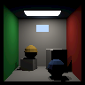
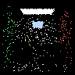
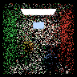
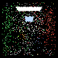
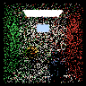
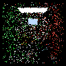

# Verified rendering results

Each golden image comes from a completed bare-metal RISC-V O3 run
with eight connected, idle accelerators. The fixed scene is 96x96
pixels. Golden PNGs apply the sRGB display transfer to the exported
linear RGB bytes; the firmware BMP and RGBA remain linear.

The smoke image shows deterministic direct lighting and shadows.
Path tracing samples emitter hits without next-event estimation;
one to four samples deliberately produce noisy images. With depth
zero, only directly visible emissive surfaces contribute light.

O3 wall time is gem5's `hostSeconds` from each `stats.txt`, measured
from the simulator's statistics timer through the final dump. It is
real elapsed time, not guest simulated time. These runs used up to
three concurrent gem5 processes, so the numbers include contention.
Native and supporting-check times use Python's monotonic clock.

| Test | Mode | Samples | Secondary depth | Seed | O3 wall (s) | Native wall (s) |
| --- | --- | ---: | ---: | ---: | ---: | ---: |
| smoke | smoke | 1 | 0 | 1 | 424.16 | 0.010656 |
| primary | path | 1 | 0 | 1 | 87.50 | 0.003757 |
| depth1 | path | 1 | 1 | 1 | 204.88 | 0.012722 |
| path4 | path | 4 | 4 | 1 | 1631.28 | 0.061065 |
| path1 | path | 1 | 4 | 1 | 413.03 | 0.016530 |
| seed2 | path | 4 | 4 | 2 | 1639.26 | 0.056545 |
| repeat | path | 4 | 4 | 1 | 1632.46 | 0.056566 |
| depth32 | path | 1 | 32 | 18446744073709551615 | 710.79 | 0.030033 |

All Scene and Job records passed validation. Every run has zero
accelerator bus packets. The firmware and all statically reserved
storage occupy 204,592 bytes, including the 16 KiB stack, within
the 256 KiB budget. Native comparisons use the numerical tolerance
described in [README.md](README.md).

The `primary`, `depth1`, and `path1` cases isolate depth changes.
`path1` and `path4` isolate sample count. `path4` and `seed2` isolate
seed. `repeat` must equal `path4` byte for byte; `depth32` checks the
maximum supported depth and unsigned 64-bit seed.

## Supporting checks

These checks do not export images. The independent smoke reference
has a maximum RGB byte error of 1.

| Check | Wall time (s) |
| --- | ---: |
| Reject --render_mode=2 | 0.155520 |
| Reject --samples_per_pixel=0 | 0.157697 |
| Reject --samples_per_pixel=4097 | 0.156211 |
| Reject --max_secondary_depth=-1 | 0.156287 |
| Reject --max_secondary_depth=33 | 0.156361 |
| Reject --seed=-1 | 0.162106 |
| Reject --seed=18446744073709551616 | 0.162169 |
| Reject --render_mode=1 --samples_per_pixel=2 | 0.164599 |
| Reject --render_mode=1 --max_secondary_depth=1 | 0.157777 |
| C suite including full-scene traversal and tiling | 0.083964 |
| Independent double-precision smoke lighting (64 pixels) | 0.133166 |

## smoke



Raw linear RGBA SHA-256:

`79aaad3486ca49955cda1dd8fd6f36b8102cbbd3c89117f327b0c917c090ccaa`

Native mean / maximum byte error: 0.000000 / 0.

## primary


Raw linear RGBA SHA-256:

`78c063b40cf4f140e17a1d7109a40a0b14ce019704e1fab3cd9b4359e4b7b531`

Native mean / maximum byte error: 0.000000 / 0.

## depth1



Raw linear RGBA SHA-256:

`29bd6b2aea40346a74cd4729a31c47177a9c0e2c8225619259cb64af9feb95c9`

Native mean / maximum byte error: 0.000000 / 0.

## path4



Raw linear RGBA SHA-256:

`a6138dfcd381274caddf68c195e6d7efbe431955c3c947943b2f83d2a65d74d5`

Native mean / maximum byte error: 0.000000 / 0.

## path1



Raw linear RGBA SHA-256:

`d36e1a5a786f8f2f77c20a6422f315018cf413ffc71284718927ce95b2a563d0`

Native mean / maximum byte error: 0.000000 / 0.

## seed2



Raw linear RGBA SHA-256:

`5280dc96efde0874db70ed5925c23be21d3ba0f4c361ba29388a44b77f9d409b`

Native mean / maximum byte error: 0.000000 / 0.

## repeat


Raw linear RGBA SHA-256:

`a6138dfcd381274caddf68c195e6d7efbe431955c3c947943b2f83d2a65d74d5`

Native mean / maximum byte error: 0.000000 / 0.

## depth32



Raw linear RGBA SHA-256:

`657ba17f12db6acb69f9814fcc3c977555ce1777ab6c75fd9accf130bdb8f78c`

Native mean / maximum byte error: 0.000000 / 0.

## Reproduce

```sh
make -C util/rt_reference check out/native
python3 util/rt_reference/validate.py --jobs=3
```

Add `--inspect-only` to recheck completed output directories.
`--write-documentation` explicitly replaces this report and the
golden images after the entire matrix passes. Complete measurements
are stored in [golden/manifest.json](golden/manifest.json).
